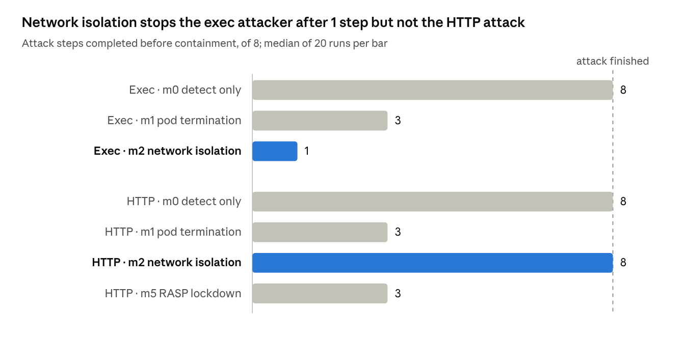
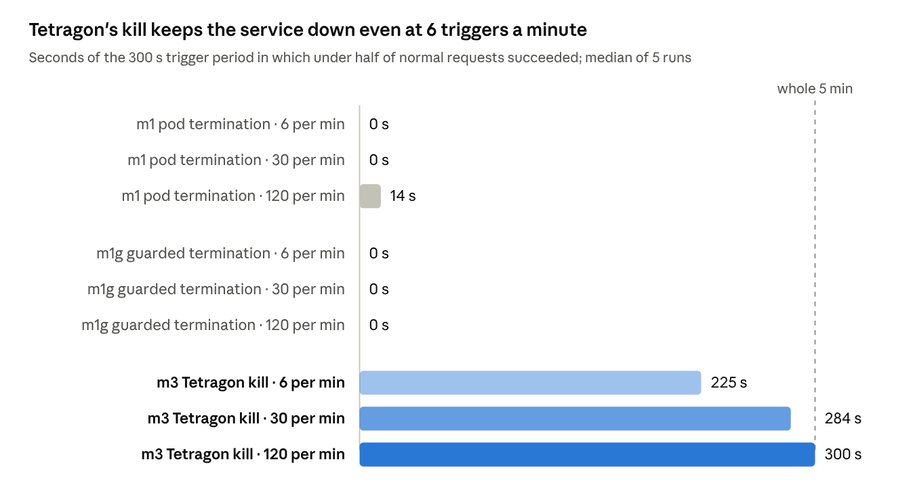
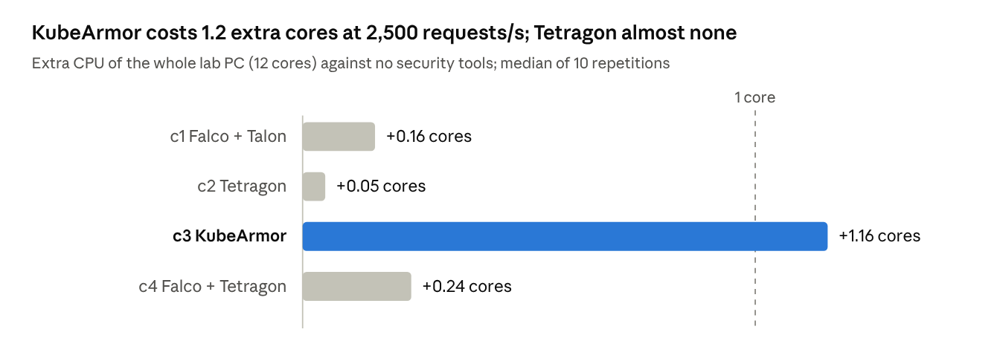
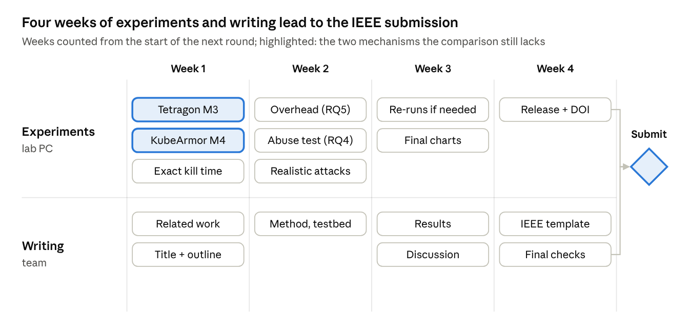

# eBPF Containment Study: Progress and Next Steps

Oct 10, 2026

Live version: https://claude.ai/code/artifact/ed08ad36-5041-4b31-96a3-c6a9863164cb (this file is an export of it).

## Summary

The paper now has measured results from 364 automated runs on a lab PC (9 to 11 October 2026), with zero failures: six responses compared against the same two attacks, plus an abuse test in which an outside attacker triggers the responses on purpose.

The original IEEE manuscript was judged not ready for a Q2 journal: it reported no measured numbers, and its tool combination was already published. We reframed it as a measurement study of what happens *after* an attack is detected.

Headline results: Kubernetes pod termination acts within 0.02 to 0.1 s, yet the attacker keeps running until 2.11 s, re-compromises the replacement pod in every run, and the evidence is lost every time. Tetragon's in-kernel kill stops the attacker within 0.09 s and keeps the evidence, but it is the easiest response to abuse: one trigger request every 10 s kept the service down 75% of the time.

Overhead: at 2,500 requests per second Tetragon added under 0.1 ms to p99 latency and Falco with Talon 0.27 ms, while KubeArmor with default visibility used 1.2 extra cores and nearly tripled p99 latency. Realistic attacks: an established public suite (Falco event-generator, mapped to MITRE ATT&CK) confirmed the mechanism behaviour, Tetragon killing the attacker's shell on spawn before any action ran. All measurements are now complete; what remains is the rewrite and submission (about 2 weeks).

## Why we changed direction

The review of the manuscript (2 October 2026) concluded it would likely be desk-rejected, for two reasons:

1. **No measurements.** Detection rate, false positives, latency and overhead were never measured; the evaluation was only a protocol.
2. **No novelty.** The working chain (Trivy, Falco, Falcosidekick, Talon, Prometheus, Grafana, Loki) is a configuration of existing tools that earlier papers already combine, and the ML layer ran only on synthetic data.

A literature check on 8 October found the obvious alternatives crowded too. ML anomaly detection on eBPF data is well covered (Zhang and Chen; Patan and Reddy; Kim et al. 2025; Ryu et al. 2025/26). Generating security policies from observed behaviour also has prior work (Confine, RAID 2020; [BEACON, 2025](https://arxiv.org/pdf/2512.00414)). We found no paper that compares automated *response* mechanisms side by side on the same attacks.

The new research question is what an automated response actually achieves after a detection:

- **RQ1 Speed:** time from attack to containment, and attack steps completed before it.
- **RQ2 Durability:** whether the workload is re-compromised afterwards.
- **RQ3 Cost:** disruption to normal users and loss of forensic evidence.
- **RQ4 Abuse:** whether an attacker can trigger the response to cause downtime.
- **RQ5 Overhead:** steady-state CPU, memory, throughput and latency cost.

The ML layer is dropped from the paper and stays in the repository as a labelled prototype.

## What we built and fixed

All work is on the `containment-eval` branch of the [GitHub repository](https://github.com/Naveen4421/real_time_security_using_ebpf/tree/containment-eval); `main` is unchanged.

| Change | Where | Why |
| --- | --- | --- |
| Experiment harness: event collector, load generator, setup scripts, scenarios, mechanisms, analysis, overnight runner | `eval/` | Runs the measurement protocol end to end, repeatably |
| Research plan | `docs/containment_study_plan.md` | Research questions, metrics, procedure |
| Shell-spawn rule matches shell programs only, not every process | `configs/falco_rules*.yaml` | Reviewer point P1-4 (false positives) |
| `RASP_ENABLED` switch, on by default | `app/backend/server.js` | Lets other mechanisms be measured without the in-app lockdown |
| Configurable host ports, Promtail 3.6.11, frontend calls the API through nginx, missing `pyyaml` | `docker-compose.yml`, `app/frontend/app.js`, `ml_pipeline/requirements.txt` | The Docker stack now runs cleanly |
| Phase table shows prototype status honestly | `README.md` | Matches what the code does |
| PDFs and raw results kept out of git | `.gitignore` | The repository is public |
| Trivy pinned to v0.36.0 and gating on fixable CRITICAL findings | branch `ci-trivy-gate` (local only) | Not pushed yet: needs a token with the `workflow` permission |

Smoke tests on the lab PC exposed measurement bugs, all fixed before the full runs:

- HTTP 500 from `spawn-shell` now counts as a completed step (the shell starts; only `whoami` fails for UID 10001).
- Response time is taken from Talon's own notification (millisecond precision), not from polling Kubernetes.
- The pod watcher timestamps each sample after its query returns.

Two claims in the manuscript are wrong and must be corrected:

- The `/bin/hack` quarantine never runs: the backend runs as non-root, so the write always fails with EACCES and no file exists to quarantine.
- Table 4 lists a Jenkinsfile, but the repository has none.

## Testbed

All runs used one dedicated lab PC (bare metal, single-node Kubernetes), started over SSH and left running unattended.

| Item | Value |
| --- | --- |
| Machine | HP 280 Pro G6, 12 CPU cores, 62 GB RAM |
| OS and kernel | Ubuntu 22.04.5, kernel 6.8.0-138, AppArmor active (BPF security module not enabled) |
| Kubernetes | k3s v1.36.5+k3s1, single node, Traefik disabled |
| Detection | Falco 0.45.0 (Helm chart 9.2.0), modern eBPF driver, plus Falcosidekick |
| Response | Falco Talon 0.3.0 (Helm chart 0.5.0) |
| Workload | Demo Node.js backend, 2 replicas, non-root (UID 10001) |
| Normal traffic | 50 requests/s, open loop, through the Kubernetes Service |
| Other load | One unrelated container (`traccar_mysql`) was running throughout |
| Run window | 9 Oct 2026 14:09 to 10 Oct 2026 01:26 (about 11 h 15 min) |

The main server that hosts our development work was ruled out for experiments: it runs production systems, has no virtualization support and its disk was 99% full. Kernel versions, chart versions and the run order are saved with every result session (`session.json`, `plan.json`).

## Experiments run

We ran four measurement sets with no failures: 364 attack and abuse runs (20 runs for every applicable mechanism and attack pair in phases 1 and 2, 5 runs for every mechanism and trigger rate in the abuse set) and 200 overhead windows.

| Mechanism | Response |
| --- | --- |
| m0 Detect only | Nothing (baseline) |
| m1 Pod termination | On a Falco alert, Talon deletes the pod (grace period 0); the Deployment recreates it |
| m1g Guarded termination | As m1, but Talon skips the deletion unless both replicas are ready (`min_healthy_replicas: 2`); abuse set only |
| m2 Network isolation | On a Falco alert, Talon creates a NetworkPolicy blocking **outbound** traffic for all replicas |
| m3 Tetragon kill | A Tetragon policy kills, in the kernel, any backend process that starts a shell or opens `/etc/shadow` or `/bin/hack` |
| m4 KubeArmor block | A KubeArmor policy (AppArmor) refuses `/bin/busybox` and opening the two files; nothing is killed |
| m5 RASP lockdown | The app returns 403 on threat routes for 30 s after 3 threat requests |

| Set | Date | Attack | Mechanisms | Runs |
| --- | --- | --- | --- | --- |
| Phase 1 | 9 Oct | Exec: shell access, then 8 benign discovery and sensitive-file steps, 1 s apart | m0, m1, m2 | 60 |
| Phase 1 | 9 Oct | HTTP: 8 calls to the app's threat endpoints, 1 s apart | m0, m1, m2, m5 | 80 |
| Phase 1 | 9 Oct | None: normal traffic only, 4 x 30 min | m0 | 4 |
| Phase 2 | 10 Oct | Exec, as above | m0, m1, m3, m4 | 80 |
| Phase 2 | 10 Oct | HTTP, as above | m0, m1, m3, m4 | 80 |
| Abuse | 10 to 11 Oct | One public request repeated at 6, 30 or 120 per minute for 5 min | m0, m1, m1g, m3 | 60 |
| Overhead | 11 Oct | None: normal traffic at 0, 500, 1,500 and 2,500 requests/s | 5 stacks: none, Falco + Talon, Tetragon, KubeArmor, Falco + Tetragon | 200 windows |

Each run deploys fresh pods, warms up for 60 s under load, starts the attack, observes for 120 s, then retries the first attack step and checks whether the attacked pod's logs survive. Run order is shuffled within each batch.

Every attack step reports to a collector outside the cluster. Falco alerts and Talon actions go to the same collector, so all times share one clock and steps are counted even after a pod is killed.

Phase 2 also records every process start and exit in the backend with Tetragon, and its step reports use `node` instead of BusyBox `wget`, because under m4 KubeArmor refuses BusyBox. Phase 2 exec timings therefore differ slightly from phase 1, so m0 and m1 were run again as controls. The abuse set sends its trigger requests through the Service, as an outside attacker would, and measures normal traffic over the 5 minutes of triggering.

## Results

### Phase 1: Kubernetes-level responses and RASP (9 Oct)

Every one of the 140 attack runs was detected and no response disrupted normal users; the mechanisms differ in how much of the attack they stopped.

*eval/results full-20261009-1409, batches s1 and s2 · 140 attack runs on the lab PC, 9 Oct 2026*

Pod termination and RASP each let the attacker finish 3 of 8 steps in both attacks. Only network isolation against the exec attack stopped it after the first step.

| Attack | Mechanism | Response time, median s [95% CI] | Attacker active, s | Re-compromised | Logs kept |
| --- | --- | --- | --- | --- | --- |
| Exec | m0 detect only | none | 7.0 | 100% | 100% |
| Exec | m1 pod termination | 0.102 [0.099 to 0.106] | 2.0 | 100% | 0% |
| Exec | m2 network isolation | 0.101 [0.098 to 0.104] | 0.0 | 0% | 100% |
| HTTP | m0 detect only | none | 7.0 | 100% | 100% |
| HTTP | m1 pod termination | 0.022 [0.018 to 0.024] | 2.0 | 100% | 0% |
| HTTP | m2 network isolation | 0.022 [0.017 to 0.022] | 7.0 | 100% | 100% |
| HTTP | m5 RASP lockdown | 3.015 [3.014 to 3.020] | 2.0 | 100% | 100% |

Falco's delay from kernel event to alert was 1.7 to 2.1 ms (median per mechanism). Normal traffic saw 0% errors under every mechanism, and 2 hours of normal-only traffic raised no alerts from our rules. After pod termination, the replacement pod was ready in 1.1 s (median, exec batch). Exec response times include about 0.08 s of `kubectl exec` start-up.

### Phase 2: in-kernel enforcement and exact exit times (10 Oct)

Tetragon stopped the attacker in both attacks before any step completed; KubeArmor refused every exec step but left the shell alive; under pod termination the attacker kept running for 2.1 s.

| Attack | Mechanism | Response, median s [95% CI] | Attacker stopped, s | Steps done | Re-compromised | Logs kept | Falco alerted |
| --- | --- | --- | --- | --- | --- | --- | --- |
| Exec | m0 detect only | none | 11.22 (script end) | 8 of 8 | 100% | 100% | 100% |
| Exec | m1 pod termination | 0.101 [0.100 to 0.103] | 2.112 [2.109 to 2.116] | 2 | 100% | 0% | 100% |
| Exec | m3 Tetragon kill | 0.090 [0.088 to 0.092] | 0.090 | 0 | 0% | 100% | 0% |
| Exec | m4 KubeArmor block | 0.497 (first refused step) | not stopped; all 8 steps refused, script ends 2.83 | 0 | 0% | 100% | 100% |
| HTTP | m0 detect only | none | not stopped | 8 of 8 | 100% | 100% | 100% |
| HTTP | m1 pod termination | 0.020 [0.017 to 0.022] | 2.028 (server process exit) | 3 | 100% | 0% | 100% |
| HTTP | m3 Tetragon kill | 0.008 [0.008 to 0.008] | 1.015 (server process killed) | 0 | 0% | 100% | 100% |
| HTTP | m4 KubeArmor block | at the first request | not stopped; 3 shell spawns refused | 5 of 8 | 0% | 100% | 100% |

The attacker's stop time is the exit of its shell (exec) or of the server process (HTTP), from Tetragon's events to the nanosecond. KubeArmor's first alert came at 1.008 s, from a file block; refused shells raised none. The 5 HTTP steps that reached the app under m4 are file reads and writes the operating system already denies. Normal traffic saw no errors except under m3 in the HTTP attack (0.8%), while the killed server restarted.

### Response abuse (RQ4, 10 to 11 Oct)

An outside attacker repeating one public request can turn the fastest response into an outage.

*eval/results abuse-20261010-2220 · 60 runs on the lab PC, 10 to 11 Oct 2026*

The attacker calls a public endpoint that makes the app open `/etc/shadow`, through the Service, so it cannot choose a replica. Under detect only (m0) the service was never down at any rate. Each Tetragon trigger kills the server process, and Kubernetes waits longer before each restart, so the pods spend most of the period waiting.

| Mechanism | Triggers per minute | Terminations or restarts | Normal-traffic errors | Time with no ready pod, s |
| --- | --- | --- | --- | --- |
| m1 pod termination | 6 | 30 terminations | 0% | 0 |
| m1 pod termination | 30 | 145 terminations | 0% (worst run 4.5%) | 0 |
| m1 pod termination | 120 | 283 terminations | 5.0% | 80 |
| m1g guarded termination | 6 | 30 terminations | 0% | 0 |
| m1g guarded termination | 30 | 149 terminations | 0% | 0 |
| m1g guarded termination | 120 | 181 terminations | 0% | 0 |
| m3 Tetragon kill | 6 | 10 restarts | 75% | 220 |
| m3 Tetragon kill | 30 | 12 restarts | 95% | 278 |
| m3 Tetragon kill | 120 | 12 restarts | 99% | 289 |

Every termination also destroys the attacked pod's logs, so even without downtime the attacker can erase evidence at will. Talon sent no notification for the deletions the replica guard skipped; the guard shows only as fewer terminations (181 against 283 at 120 per minute).

### Overhead (RQ5, 11 Oct)

Tetragon's cost was within measurement noise and Falco's was small; KubeArmor with its default visibility cost more than a core.

*eval/results overhead-20261011-0933 · 200 windows of 60 s on the lab PC, 11 Oct 2026*

Each of five stacks was switched on in turn, 10 times in random order, with the app under 0, 500, 1,500 and 2,500 requests per second for 60 s each; 2,500 is about 80% of what the app can serve. The agents' own CPU and memory come from their cgroups. The kernel bills eBPF work to the process that triggers it, so Tetragon's own pod shows almost no CPU and its cost can appear only in the app's CPU and latency.

| Stack | Requests/s | Agents' own CPU, cores | Agents' memory, MB | p99 latency, ms [95% CI] |
| --- | --- | --- | --- | --- |
| c0 no tools | 1,500 | 0 | 11 | 0.52 [0.52 to 0.54] |
| c0 no tools | 2,500 | 0 | 11 | 0.77 [0.73 to 0.87] |
| c1 Falco + Talon | 1,500 | 0.032 | 205 | 0.54 [0.53 to 0.55] |
| c1 Falco + Talon | 2,500 | 0.044 | 203 | 1.04 [0.96 to 1.14] |
| c2 Tetragon | 1,500 | 0.001 | 105 | 0.53 [0.52 to 0.54] |
| c2 Tetragon | 2,500 | 0.001 | 85 | 0.82 [0.73 to 1.30] |
| c3 KubeArmor | 1,500 | 0.457 | 153 | 0.64 [0.61 to 0.65] |
| c3 KubeArmor | 2,500 | 0.766 | 154 | 2.21 [1.93 to 2.75] |
| c4 Falco + Tetragon | 1,500 | 0.033 | 304 | 0.54 [0.53 to 0.55] |
| c4 Falco + Tetragon | 2,500 | 0.045 | 293 | 1.18 [0.94 to 38.1] |

No stack caused request errors. The 11 MB under no tools is Tetragon's operator, a small helper that stays running when the agent is off. At 500 requests per second the no-tools baseline was slower than the stacks with agents running, most likely because the nearly idle CPU drops to a lower speed; that level is left out of the comparison.

### Realistic attacks (RQ6, 11 Oct)

To answer the reviewer point that our attacks were self-written (P0-2), we ran an established public attack suite instead: 13 Falco event-generator `syscall` actions, each tagged with a MITRE ATT&CK for Containers technique, covering credential access, execution, defense evasion, discovery and privilege escalation. They run inside the target container as its non-root user. 100 runs, none failed.

| Mechanism | Actions that ran (of 13) | Falco detected | Containment | First response |
| --- | --- | --- | --- | --- |
| m0 detect only | 13 | 100% | none | alert 0.51 s |
| m1 Talon terminate | about 1 | yes | pod deleted; attacker got ~1 action in | 0.52 s |
| m3 Tetragon kill | 0 | n/a | shell killed on spawn, before any action | kill 0.50 s |
| m4 KubeArmor block | 13 | 100% | every sensitive open and exec refused (shell stays alive) | block 0.93 s |
| m5 in-app RASP | 13 | 100% | none (blind to syscall attacks) | none |

Falco fired real default rules across the suite (fileless/memfd execution, ptrace, symlink and hardlink over sensitive files, credential and private-key searches, /dev/shm execution) plus our two eval rules. The suite confirms the mechanism behaviour seen in the hand-written attacks on an independent, reproducible attack set. Two honest notes: under Tetragon the shell dies so fast that the detection pipeline logs nothing (detection and in-kernel kill trade off), and the per-action detection figure for m1 is inflated by time-window attribution, so the reliable figures are the session-level ones.

## Key findings

No single response wins on every measure, which supports recommending a layered response in the paper.

1. **Detection is not the bottleneck.** Falco alerted about 2 ms after the kernel event whenever the attack executed. Under Tetragon it raised no alert in the exec attack, because the shell was killed before it started.
2. **Pod termination looks fast but is not.** Talon acts in 0.02 to 0.1 s, but the attacker's shell keeps running until 2.11 s (exec) and the server process until 2.03 s (HTTP), in every run. The replacement pod is ready in about 1.1 s and is compromised again every time, and the attacked pod's logs are lost every time.
3. **In-kernel termination stops the attacker at once.** Tetragon killed the attacker's shell 0.09 s after the attack started, the time `kubectl exec` takes to start it, with no step completed, no re-compromise and the evidence kept. In the HTTP attack it killed the server process itself, costing normal users 0.8% errors while it restarted.
4. **LSM blocking is limited by the image.** On the Alpine image `/bin/sh` is a link to BusyBox, so KubeArmor can block a shell only by blocking every BusyBox tool. The attacker's entry shell still starts, every command it runs is refused, and the refused shells raise no KubeArmor alert.
5. **Network isolation depends on the direction of the attack.** It stopped an attacker who needs outbound connections after 1 of 8 steps, but did nothing against the inbound HTTP attack, because Talon blocks outbound traffic only.
6. **RASP only delays the attacker,** who gets back in once its 30 s lockdown ends.
7. **The fastest response is the easiest to abuse.** Under Tetragon, an outside attacker repeating one public request every 10 s kept the service down 225 of 300 s: every trigger kills the server and Kubernetes' restart delay keeps growing. Pod termination stayed available up to 30 triggers per minute and lost 14 s at 120 per minute, and Talon's replica guard removed that outage.
8. **Overhead ranks differently from protection.** Tetragon, the strongest responder, was also the cheapest to run (within noise); Falco with Talon cost about 0.16 cores and 0.27 ms of p99 latency at 2,500 requests per second, and KubeArmor with default visibility about 1.2 cores and 1.4 ms.
9. **An established attack suite gives the same ranking.** The MITRE-tagged event-generator suite reproduced the hand-written results: Tetragon contained earliest (before any of 13 actions ran), KubeArmor refused each action but left the shell alive, Talon let about one action through, and in-app RASP missed the syscall-level attacks entirely.

## Limitations

These limits must be stated in the paper.

- **Policies still match the attack behaviours.** The hand-written scenarios have been supplemented with an established public suite (event-generator, RQ6), so the attacks are no longer only our own (reviewer point P0-2 addressed). The Tetragon and KubeArmor policies, however, still target the shell-spawn and sensitive-file behaviours that the suite also exercises, so this measures mechanism behaviour, not policy-authoring difficulty.
- **Inline policies were written to match the attacks.** A real policy that kills or refuses every shell would also break legitimate shell use, which this app does not have.
- **Overhead covers one light HTTP workload.** The app does little work per request, and the lowest load level (500 requests/s) is confounded by CPU power saving; KubeArmor was measured only with its default visibility.
- **Single node, shared lab PC.** One unrelated container ran throughout; multi-node behaviour is untested (P1-2).
- **Abuse used 5 runs per cell,** each covering 5 minutes and up to 600 trigger requests.
- **Phase 1 timing was coarse.** Its steps ran 1 s apart; phase 2 replaced the attacker's stop time with Tetragon's exact process exit time.
- **Zero false positives is expected** from two narrowly scoped rules and says little about real workloads.

## Experiments: complete

All planned measurements are done. What remains is writing up the results and submitting.

| Priority | Experiment | Status | Why it matters |
| --- | --- | --- | --- |
| 1 | Tetragon in-kernel kill (M3) and KubeArmor block (M4) | Done 10 Oct, 160 runs | Core comparison of in-kernel and Kubernetes-level responses; reviewer P0-3 |
| 2 | Exact process-exit times | Done 10 Oct, from Tetragon | Makes the 2 s gap precise and shows its cause |
| 3 | Attacker abuse (RQ4) | Done 11 Oct, 60 runs | Not found in published work |
| 4 | Overhead (RQ5): 5 stacks, idle and 3 load levels, 10 repetitions | Done 11 Oct, 200 windows | Every reviewer asks for it; P0-1 |
| 5 | Realistic attacks: Falco event-generator, mapped to MITRE ATT&CK | Done 11 Oct, 100 runs | Established public attacks instead of self-written scripts; P0-2 |

Dropped from scope (future work, not needed for the containment argument): CI cost (Trivy build time and findings per image), and Atomic Red Team, whose container techniques largely do not apply to this Alpine workload.

## Writing and submission

The writing can start now in parallel with the experiments; reviewer point codes are in brackets.

**Writing**

- [ ] New title and abstract built on the findings, with 3 or 4 headline numbers (P2-7, P2-8). Working title: *Measuring Automated Runtime Containment in Kubernetes: Speed, Durability, Evidence, and Abuse of eBPF-Based Responses*.
- [ ] Restructure from 13 sections to 8, following section 8 of `docs/containment_study_plan.md` (P2-1).
- [ ] Remove the ML layer and the eBPF code-generation stages; one sentence in future work (P1-3).
- [ ] Rewrite related work: 35 to 50 references, at least 25 peer-reviewed, ending in a comparison table (P1-1).
- [ ] Correct the `/bin/hack` quarantine claim, the shell-rule wording and the undefined "Phase 1 validation runner" (P1-4).
- [ ] Results: one subsection per research question, each with a figure or table (P1-5).
- [ ] Replace screenshots with plotted results and a timing diagram (P2-5).
- [ ] Cut repeated disclaimers and the uncited remark about other papers in the introduction (P2-2, P2-3).

**Packaging**

- [ ] Tagged release of the repository, archived on Zenodo for a DOI, with a code and data availability statement (P0-5).
- [ ] Decide whether raw results (58 MB) go in the public repository or only on Zenodo.
- [ ] Move to the target journal's template (IEEEtran or IEEE Access) and apply the citation fixes from the review (P3-1, P3-2).
- [ ] Declarations: data availability, conflict of interest, funding, author contributions, and AI use (Claude helped build the harness and analysis).
- [ ] Run the institution's similarity check with the bibliography excluded.
- [ ] Choose the target journal and check its current SJR quartile.

**Draft abstract (updated 11 Oct, all results in)**

Automated response to runtime threats is usually judged by detection, but its value depends on what happens after the alert. We measure five automated containment mechanisms in Kubernetes against a detect-only baseline and the same two scripted attacks: pod termination and network isolation through Falco Talon, in-kernel process termination with Tetragon, LSM-based blocking with KubeArmor, and in-application self-protection, with Falco's modern eBPF driver as the common detector. On a single-node k3s testbed, each applicable mechanism and attack pair ran 20 times with fresh pods under steady benign load, with all events timed on one clock and no runs discarded. Falco alerted about 2 ms after the kernel event whenever the attack executed. Pod termination acted within 0.02 to 0.1 s, yet the attacker kept running until 2.1 s, re-compromised the replacement pod in every run, and the attacked pod's logs were lost every time. Network isolation did nothing against an inbound attack. In-kernel termination stopped the attacker within 0.09 s with no step completed and the evidence kept, while LSM blocking on an Alpine image could not block a shell without blocking every BusyBox tool and refused shells without raising an alert. The fastest response was also the easiest to abuse: an outside attacker sending one trigger request every 10 s kept the service unavailable 75% of the time under in-kernel termination, while pod termination stayed available up to 30 triggers per minute and a replica guard removed its outage at 120. At 2,500 requests per second, Tetragon added under 0.1 ms to p99 latency and Falco with Talon 0.27 ms, while KubeArmor with default visibility used 1.2 extra cores and nearly tripled p99 latency. An established public attack suite (Falco event-generator, mapped to MITRE ATT&CK) reproduced this ranking: in-kernel termination contained the attacker before any of thirteen techniques ran, while in-application protection was blind to the syscall-level attacks entirely. No mechanism wins on speed, durability, evidence, abuse and cost together, which argues for a layered response. Configurations, scripts and raw run data are released.

## Timeline and owners

*plan · 4 weeks, 2 lanes, 1 gate*

Status on 11 October: all experiments (in-kernel mechanisms, exact exit times, abuse, overhead and realistic attacks) are complete, so the measurement phase is finished about a week ahead of this plan. The remaining work is writing. Owners are not assigned yet: the team should name a lead author for each paper section.

## Housekeeping and open decisions

Two security items should be done first; the rest can wait until submission.

- [ ] Revoke the two GitHub tokens that were pasted into the chat.
- [ ] Push the local commits on `containment-eval` (phase 2, abuse and overhead code) and branch `ci-trivy-gate`, with a new token that has the `workflow` permission.
- [ ] Remove the development server's SSH key from the lab PC's `~/.ssh/authorized_keys` once experiments end.
- [ ] Decide on Jenkins: add a Jenkinsfile or drop Jenkins from the paper.
- [ ] Merge `containment-eval` into `main` once the paper's experiments are final.
- [ ] Tell the lab admin that the lab PC's Docker apt source (`https://www.docker.com jammy`) is broken and returns 404.
- [ ] When finished, remove Tetragon, Falco and k3s from the lab PC (`eval/README.md`, Risks and cleanup).

Results are saved on the lab PC under `eval/results/` and backed up on the development server in the same path.
